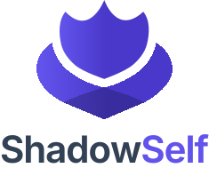
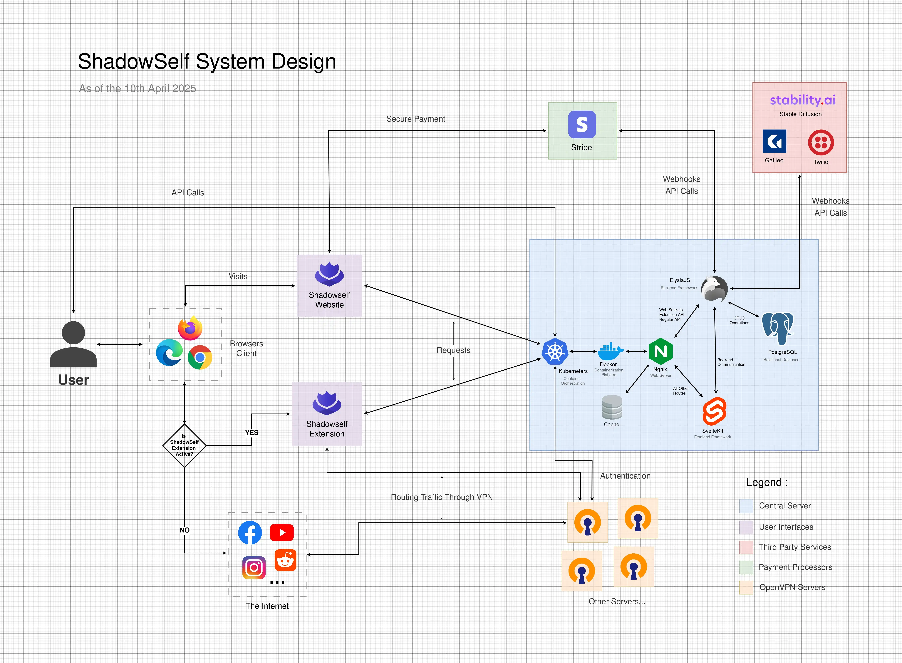

<p align="center">
  <picture>
    <source media="(prefers-color-scheme: dark)" srcset="./application/frontend/src/lib/images/brands/shadowself/logo-white-text.svg">
    
  </picture>
</p>

## Introduction

[ShadowSelf](https://shadowself.io) is a privacy platform for creating and managing complete online identities. Each identity has its own profile, contact details, accounts, wallets, and residential connection, allowing people to use online services without sharing their personal details with every website.

The platform keeps each identity's conversations, credentials, payments, and files in one workspace. Identities remain separate and available through the website, browser extension, and public API.

## Features

- Customizable synthetic profiles with names, portraits, biographies, and personal details
- Dedicated email inboxes with replies, forwarding, drafts, and attachments
- Phone numbers for sending and receiving SMS
- Encrypted account vaults with passwords, two-factor authentication, and recovery details
- Bitcoin, Litecoin, Ethereum, USDT, and Monero wallets with transfers and exchanges
- Virtual payment cards with spending limits
- Residential proxies assigned to individual identities
- File storage and image privacy tools, including metadata removal and watermarking
- Browser extension and public API access

## Notes

Vault passwords, two-factor secrets, and wallet keys are encrypted locally before storage. Each identity has its own master password, which stays in the browser. Profiles, ordinary email, SMS, and billing records are outside that encryption.

Wallet recovery phrases provide access independently of ShadowSelf and should be stored separately. Monero also has a standard Monero recovery phrase for use with other Monero wallets.

## Local development

Local development requires Bun and a running PostgreSQL server. Extension packaging also uses Bash, jq, zip, and unzip.

### Setup

Dependencies and the environment file are prepared from the repository root:

```sh
bun install --frozen-lockfile
bun install --cwd application/backend --frozen-lockfile
bun install --cwd application/frontend --frozen-lockfile
cp application/.env.example application/.env
```

`application/.env` holds the configuration for all components. Local development uses `APP_ORIGIN=http://localhost:5000`, `BACKEND_URL=http://localhost:3000`, and `POSTGRES_HOST=localhost`, with database credentials and service secrets configured in the same file.

### Database

The example configuration uses a database named `shadowself` and the PostgreSQL administrator `postgres`. A fresh local database is initialized with:

```sh
createdb -h localhost -U postgres shadowself
bun --env-file=application/.env run psql \
  -h localhost -U postgres -d shadowself -v ON_ERROR_STOP=1 \
  -f application/database/schemas.sql \
  -f application/database/roles.sql
```

The schema command recreates application tables and is intended for a fresh development database.

### Servers

The backend and frontend run in separate terminals from the repository root:

```sh
bun run --cwd application/backend dev
```

```sh
bun run --cwd application/frontend dev
```

The website runs at `http://localhost:5000`; the backend listens on port `3000`.

### Browser extension

Development packages are generated with:

```sh
bash .scripts/pack-extension.sh /tmp/shadowself-extension --development
```

The selected browser archive is extracted before loading it. Chromium browsers use **Load unpacked** in the extensions page. Firefox uses **Load Temporary Add-on** in `about:debugging`, selecting the extracted `manifest.json`.

## Project notes

Billing, provider integrations, and service administration are maintained specifically for ShadowSelf. These areas are published for reference and are not general contribution targets.



## Contributing

Bug reports, ideas, and contributions to other areas are welcome through [issues](https://github.com/RedeemedSpoon/ShadowSelf/issues) and [pull requests](https://github.com/RedeemedSpoon/ShadowSelf/pulls). Contribution guidelines are available in [CONTRIBUTING.md](CONTRIBUTING.md).

## License

ShadowSelf is licensed under the [GNU Affero General Public License 3.0](COPYING).
