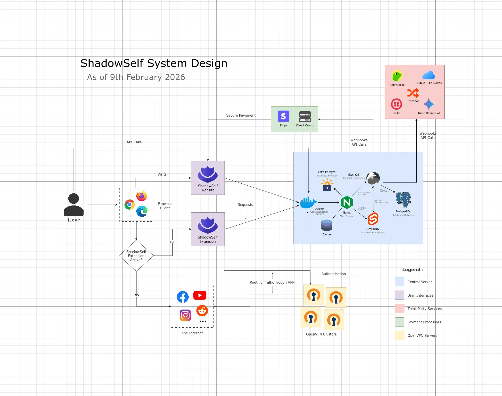

<p align="center">
  <picture>
    <source media="(prefers-color-scheme: dark)" srcset="./application/frontend/src/lib/images/brands/shadowself/logo-white-text.svg">
    
  </picture>
</p>

## ShadowSelf overview

[ShadowSelf](https://shadowself.io) lets you create synthetic identities with their own profiles, phone numbers, email addresses, credentials, wallets, virtual cards, residential connections, and files. Use an identity to register for services without handing every site your personal contact details.

An identity is meant to last. Its inbox, recovery details, and accounts stay together, so you can return to it when you need it. Browser encryption protects vault passwords, TOTP secrets, and wallet keys. Profiles, ordinary email, SMS, and billing records are outside that encryption. A separate identity does not make cookies, browser fingerprints, or public blockchain activity disappear.

The website, API, and extension are open source. This is an independent project maintained by one developer, with contributions welcome. Paid identities cover hosting, provider costs, and development.

## Running locally

### Requirements

- Bun for the application servers, dependencies, and builds.
- PostgreSQL for application and mail data.
- Configured mail infrastructure and provider accounts for the services you enable.
- Docker Compose and Nginx for the container deployment.

### Application

Install dependencies in the repository root and both application directories:

```sh
bun install --frozen-lockfile
cd application/backend
bun install --frozen-lockfile
cd ../frontend
bun install --frozen-lockfile
```

Create local `.env` files in `application/backend`, `application/frontend`, and `application/database`. [Backend configuration](application/backend/src/core/config.ts) lists the application secrets and provider settings. Keep credentials out of Git.

For a fresh development database, initialize [schemas.sql](application/database/schemas.sql), then [roles.sql](application/database/roles.sql). Supply `POSTGRES_DB`, `APP_DB_PASSWORD`, and `MAIL_DB_PASSWORD` from your database configuration:

```sh
psql -v ON_ERROR_STOP=1 -U postgres -d "$POSTGRES_DB" \
  -f application/database/schemas.sql \
  -f application/database/roles.sql
```

The schema drops and recreates application tables. Use a disposable development database.

### Frontend

Run these commands from `application/frontend`:

| Command         | Purpose                         |
| --------------- | ------------------------------- |
| `bun dev`       | Development server on port 5000 |
| `bun run build` | Production build                |
| `bun preview`   | Preview the build on port 5000  |
| `bun start`     | Run the production server       |

### Backend

Run these commands from `application/backend`:

| Command         | Purpose                         |
| --------------- | ------------------------------- |
| `bun dev`       | Development server on port 3000 |
| `bun run build` | Compile the backend executable  |
| `./server`      | Run the compiled backend        |

Browser API requests use the website's `/api` routes. The frontend forwards them to the backend on the same origin. Visit `/docs` for authentication, endpoints, request formats, and errors.

### Browser extension

Build packages from the repository root:

```sh
bun run package:extension
```

For local development:

```sh
bash .scripts/pack-extension.sh /tmp/shadowself-extensions --development
```

Extract the package for your browser and load it as an unpacked extension. Development packages request access to `http://localhost:5000`; production packages use `https://shadowself.io`. Connect the extension to a signed-in ShadowSelf tab to open identities while browsing.

### Linting, formatting, and tests

Run checks from the repository root:

```sh
bun format
bun lint
bun check
bun test
bun run build
```

`bun run verify` runs lint, type checks, permanent tests, and builds. `bun run audit` checks dependency advisories. Test fixtures are synthetic and the integration database must be isolated from development data.

### Quick tmux session

[tmux-session.sh](.scripts/tmux-session.sh) starts the frontend and backend in separate panes:

```sh
bash .scripts/tmux-session.sh
```

## Deployment

Run Docker Compose from `application` after configuring its environment:

```sh
cd application
docker compose up --build
```

[compose.yaml](application/compose.yaml) defines the website, backend, database, and TLS services. Set `APP_ORIGIN` to the public HTTPS origin, `POSTGRES_HOST=postgres`, and the billing callback under `/api/webhooks/stripe`. Enable cryptocurrency billing after configuring and validating the Monero wallet.

Nginx supplies the trusted host and protocol headers for HTTPS and onion access. Compose clears the frontend `ORIGIN` setting. Nginx applies per-client API rate limits; frontend form actions have their own address limits. The backend does not resolve ingress hosts or trust forwarded client IPs. Keep the backend private behind Nginx.

The operations scripts take explicit targets. Configure `SHADOWSELF_SSH_TARGET` and `SHADOWSELF_DB_CONTAINER` for database backups and queries. Schedule maintenance through your host scheduler.

## Contribution

Found a bug or have an idea? [Open an issue](https://github.com/RedeemedSpoon/ShadowSelf/issues). Have a fix? [Open a pull request](https://github.com/RedeemedSpoon/ShadowSelf/pulls).

Read [CONTRIBUTING.md](CONTRIBUTING.md) and [AGENTS.md](AGENTS.md) before changing the code. The current application has no production users or data to migrate. Update the fresh schema directly and keep frontend and backend contracts together.

The original system design shows how the project was put together in February 2026:



## License

ShadowSelf is licensed under [GNU Affero General Public License 3.0](COPYING). You can use, modify, and distribute the code under that license's terms.

### Provider availability and browser connections

Phone and residential network integrations are unconfigured. Phone requests, new purchases, and identity provisioning return HTTP 503 until replacement providers are implemented. Existing crypto renewals remain available when billing is configured. Profile location is descriptive text and does not reserve an IP address or choose a network provider.

Set `CSP_CONNECT_ORIGINS` in the frontend environment to a comma-separated list of exact HTTPS origins permitted for browser connections. Rebuild after changing it. Include `https://api.stripe.com` for card payments and the origin of each configured Monero node for browser wallet sync. The default permits only same-origin connections. For Stripe, also set `CSP_SCRIPT_ORIGINS=https://js.stripe.com` and `CSP_FRAME_ORIGINS=https://js.stripe.com,https://hooks.stripe.com`. These allowlists default to no external origins.

`mailbox_password_encrypted` holds the encrypted credential so the backend can authenticate to IMAP and SMTP. `mailbox_password_hash` is a separate SHA-256 verifier used by Dovecot. Deletion revokes mailbox access by removing the identity; the mail cleanup script removes directories with no identity or service-mailbox owner, including files from previously frozen identities.
